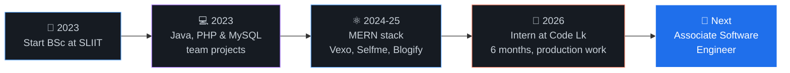

<!-- ═══════════════════════ BANNER ═══════════════════════ -->
<div align="center">


<a href="https://git.io/typing-svg">
  
</a>

<br/>


<br/><br/>


</div>

<br/>

<div align="center">

</div>

<!-- ═══════════════════════ CONNECT ═══════════════════════ -->
<h2 align="center">🌐 Connect With Me</h2>

<div align="center">

<a href="https://www.linkedin.com/in/hasarangamn/"></a>
<a href="mailto:hasaranganavoda2025@gmail.com"></a>
<a href="https://github.com/Hasaranga22"></a>
<a href="http://Hasaranga22.me/"></a>
<a href="https://medium.com/@Hasaranga22"></a>

</div>

<br/>

<!-- ═══════════════════════ ABOUT ═══════════════════════ -->
<h2 align="center">👨‍💻 About Me</h2>

<table align="center">
<tr>
<td width="55%" valign="top">

```yaml
name:       Navoda Hasaranga
role:       Associate Software Engineer
focus:      Full-Stack Web Development
education:  BSc (Hons) IT, Software Eng. @ SLIIT
experience: Software Engineer Intern @ Code Lk
location:   Sri Lanka 🇱🇰
status:     Open to opportunities 🚀
```

</td>
<td width="45%" align="center" valign="middle">


</td>
</tr>
</table>

<p align="center">
Software Engineering undergraduate and full-stack developer who completed a <b>6-month internship at Code Lk (Pvt) Ltd</b>.<br/>
I build and maintain web applications with REST APIs, relational databases and clean MVC architecture,<br/>
working in agile teams on real production projects.
</p>

<div align="center">

```diff
+ 🔭 Currently working on   → Blogify & Vexo enhancements
+ 👯 Open to collaborate on → Full-stack web projects (React, Node, Next.js, NestJS)
+ 🌱 Currently learning     → Advanced Next.js, NestJS & clean architecture
+ 💬 Ask me about           → MERN stack, REST APIs, SQL, CodeIgniter
+ ⚡ Fun fact               → I've built apps in MERN, Java/JSP and PHP stacks
```


<br/>
<sub><i>Me, debugging at 2 AM</i></sub>

</div>

<br/>

<div align="center">

</div>

<!-- ═══════════════════════ SKILLS ═══════════════════════ -->
<h2 align="center">🛠️ Tech Arsenal</h2>

<div align="center">


<br/><br/>

### 🎨 Frontend


### ⚙️ Backend

<br/><br/>


### 🗄️ Databases


### 🧰 Tools & Deployment

<br/><br/>


### 🤝 Practices


<br/><br/>


</div>

<br/>

<div align="center">

</div>

<!-- ═══════════════════════ EXPERIENCE ═══════════════════════ -->
<h2 align="center">💼 Professional Experience</h2>

<div align="center">

### 🏢 Software Engineer Intern · Code Lk (Pvt) Ltd
`6 Months` &nbsp;•&nbsp; `Completed September 2026`

</div>

```text
▸ Contributed to real-world, production-level projects across the full development lifecycle
▸ Consistently met sprint deadlines with positive feedback on code quality and reliability
▸ Collaborated with senior engineers: code reviews, debugging and production deployments
▸ Strengthened RESTful API design, SQL query optimization and component-based React development
▸ Used Swagger, Postman and SonarQube for API documentation, testing and code quality
```

| 🚀 Project | 📝 Contribution |
|:---|:---|
| 🏛️ **Land Registry Department** | Records-management and workflow-processing modules for a government system digitizing land ownership data |
| 🌳 **Sri Lanka Rubber Department** | Performed **data patching**: correcting and updating records directly in the database to keep department data accurate and consistent |
| 🎓 **YICD Learning Management System** | Course management, user-role handling and content-delivery modules for online learning |
| 🖼️ **Sam Art Museum (SAM)** | Gallery and exhibit content management plus a public-facing collections showcase |

<div align="center">

<br/>
<sub><i>Patching production data (carefully)</i></sub>
</div>

<br/>

<div align="center">

</div>

<!-- ═══════════════════════ PROJECTS ═══════════════════════ -->
<h2 align="center">🚀 Featured Projects</h2>

<table align="center">
<tr>
<td width="50%" valign="top">

### 🛍️ Vexo · E-Commerce Store
Full-stack clothing platform with product listing, cart, authentication, order management, admin dashboard, online payments and email notifications.


[🔗 Live Demo](https://vexo-opal.vercel.app/)

</td>
<td width="50%" valign="top">

### ☀️ Selfme.lk · ERP System
Team project for a solar energy company: inventory with re-order levels, multi-role admin dashboard, technical team and task management, and a finance module.


[🔗 Source Code](https://github.com/Hasaranga22/Selfme_)

</td>
</tr>
<tr>
<td width="50%" valign="top">

### ✍️ Blogify · Blogging Platform
Rich-text blogging platform with secure JWT authentication and three roles: Admin, Author and Reader.


[🔗 Source Code](https://github.com/Hasaranga22/Blogify)

</td>
<td width="50%" valign="top">

### 🏨 Hotel Reservation System
Room-booking app built with OOP and MVC: users book, update and cancel reservations; admins manage rooms, bookings and customers.


[🔗 Source Code](https://github.com/Hasaranga22/Hotel-Reservation-System)

</td>
</tr>
<tr>
<td colspan="2" valign="top">

### 🛒 Yatawara Grocery Shop
Full-stack grocery site with session-based login and role management: owners manage items and orders, customers browse and order products.


[🔗 Source Code](https://github.com/Hasaranga22/Grocery-Shop)

</td>
</tr>
</table>

<br/>

<div align="center">

</div>

<!-- ═══════════════════════ STATS ═══════════════════════ -->
<h2 align="center">📊 GitHub Stats</h2>

<div align="center">


<br/>


</div>

<br/>

<!-- ═══════════════════════ JOURNEY (replaces broken trophies / activity graph) ═══════════════════════ -->
<h2 align="center">🧭 My Developer Journey</h2>



<div align="center">


<br/><br/>


<br/>
<sub><i>It works on my machine ™</i></sub>

</div>

<br/>

<div align="center">

</div>

<!-- ═══════════════════════ EDUCATION ═══════════════════════ -->
<h2 align="center">🎓 Education</h2>

| 🏫 Institute | 📘 Program | 📅 Period |
|:---|:---|:---:|
| **SLIIT** | BSc (Hons) in IT, Specializing in Software Engineering · GPA 3.39 | 2023 – 2027 |
| **Thurstan College, Colombo 07** | Advanced Level, Physical Science (Combined Maths, Physics, ICT) | 2019 – 2021 |

<br/>

<!-- ═══════════════════════ CONTACT ═══════════════════════ -->
<h2 align="center">🤝 Let's Build Something Together</h2>

<div align="center">


<p>
I'm actively looking for an <b>Associate Software Engineer</b> opportunity where I can<br/>
contribute to real products and keep growing alongside a strong engineering team.
</p>

<a href="mailto:hasaranganavoda2025@gmail.com"></a>

<br/><br/>


<br/>


</div>
